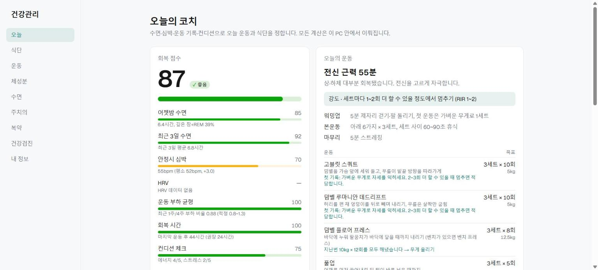
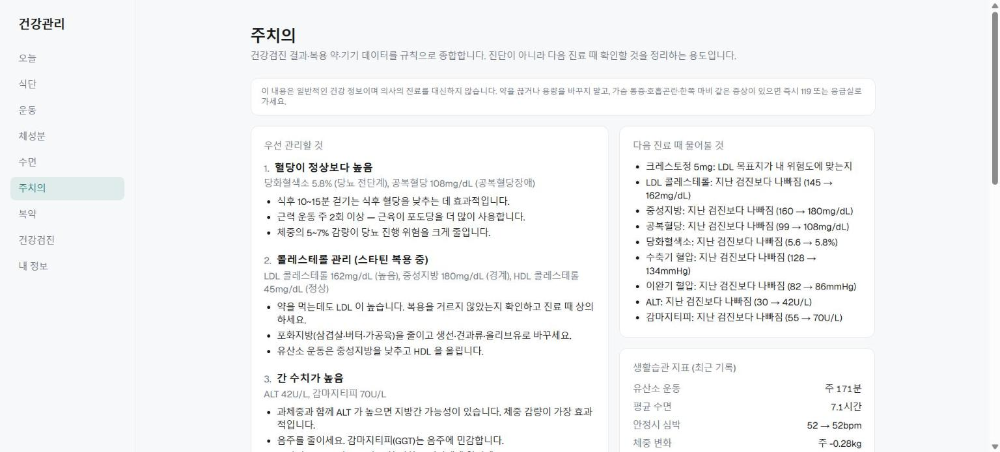
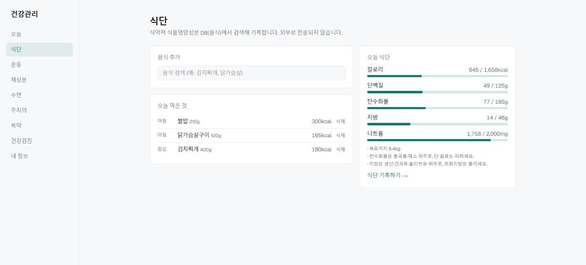

# 건강관리 (health-hub)

스마트워치·스마트체중계 데이터와 건강검진·복약 기록을 한곳에 모아, **개인 운동 코치**와 **개인 주치의**처럼 쓰는 웹페이지입니다.

- **운동 코치** — 그날의 수면·안정시 심박·운동 부하·컨디션으로 회복 점수를 매기고, 러닝·실내자전거·덤벨·철봉 중 오늘 할 운동과 무게·횟수, 식단 목표를 정해 줍니다.
- **주치의** — 건강검진 결과(연도별 추이)와 복용 약을 종합해 우선 관리할 것과 다음 진료 때 물어볼 것을 정리합니다.
- 모든 판단은 서버 안의 **규칙 엔진**으로 계산합니다. 건강 데이터를 외부 AI 서비스로 보내지 않습니다.

> 대상 기기: 가민 포러너 165(스마트워치), 앳플리 TX(스마트체중계) — Android Health Connect 로 연동

## 화면

> 아래 화면의 수치는 모두 가상 데모 데이터입니다.

**오늘의 코치** — 회복 점수와 요소별 근거, 오늘의 운동 처방 (지난 기록 기반 무게·횟수)



**주치의** — 검진 결과·복용 약 종합, 우선 관리 항목, 다음 진료 때 물어볼 것



**식단** — 식약처 음식 DB 검색으로 기록, 목표 대비 섭취량



## 주요 기능 (웹)

| 메뉴 | 내용 |
| --- | --- |
| 오늘 | 회복 점수(0~100), 오늘의 운동 처방, 컨디션 체크, 식단 요약, 주간 운동 진행, 부위별 회복도 |
| 식단 | 음식 검색·기록, 최근 먹은 음식 다시 기록, 칼로리·단백질·탄수화물·지방·나트륨 목표 대비 섭취 |
| 운동 | 러닝·자전거 기록, 가민 FIT 파일 업로드(GPS 경로·랩), 근력 운동 기록 |
| 체성분 · 수면 | 체중·체지방 등 측정 기록, 수면 기록 |
| 주치의 | 검진 항목 판정과 추이, 복용 약별 주의점과 함께 볼 검사, 생활습관 지표 |
| 복약 · 건강검진 · 내 정보 | 약·검진 결과 입력, 나이·키·목표·보유 운동기구 설정 |

판단 규칙(회복 점수 가중치, 운동 선택, 점진적 과부하, 식단 목표, 검진 판정 기준)은 [docs/coach.md](docs/coach.md) 에 정리했습니다.

### 참고한 상용 서비스

- **Garmin Training Readiness** — 회복 점수의 입력 요소와 구간(최상·좋음·보통·낮음·매우 낮음)
- **WHOOP · Oura** — 안정시 심박·HRV 를 내 평소 값과 비교하는 방식
- **Fitbod** — 부위별 피로도, 점진적 과부하(목표 반복을 채우면 무게 올리기)
- **식약처 K-FIND 식품영양성분 DB** — 음식 영양 정보

## 기술 스택

- **웹**: Next.js 16 (App Router, Cache Components), TypeScript, Tailwind CSS
- **DB**: PostgreSQL + Prisma 7
- **규칙 엔진**: 순수 TypeScript 패키지 (`packages/coach`, 단위 테스트 포함)
- **모노레포**: npm workspaces + Turborepo

```
apps/
  web/            웹페이지 + API
  sync-app/       Android 동기화 앱 (Expo) — 추후 개발
packages/
  coach/          코치·주치의 규칙 엔진
  db/             Prisma 스키마 · 마이그레이션
  ingest/         Health Connect 레코드·가민 FIT 파일 변환, 중복 제거
  shared/         공용 타입 (측정 항목, 동기화 형식, 검진 항목)
jobs/             스크립트 (음식 DB 가져오기, 복약 누락 기록, 주간 리포트)
docs/             동작 방식, 기기 연동 안내, 스크린샷
```

## 실행 방법

Node.js 22 이상이 필요합니다.

```bash
npm install
cp .env.example .env          # SYNC_TOKEN 생성 방법은 파일 안 설명 참고
```

DB 실행 (둘 중 하나)

- **Docker 가 있으면**: `npm run db:up` (`.env` 기본값 그대로)
- **Docker 없이**: `npm run db:dev -w @health/db` → 출력되는 `postgres://...` (TCP) 주소를 `.env` 의 `DATABASE_URL` 에 넣고, `DATABASE_POOL_MAX=1` 추가

```bash
npm run db:migrate            # 테이블 생성
npm run dev                   # http://localhost:3000
```

처음 열면 **내 정보**(나이·성별·키·보유 덤벨·철봉/실내자전거)를 먼저 입력하세요.

**음식 DB 가져오기** (식단 기록용, 한 번만): [K-FIND 영양성분 DB 내려받기](https://various.foodsafetykorea.go.kr/nutrient/general/down/list.do)에서 **음식 DB** 엑셀을 받은 뒤

```bash
npm run import-foods -w @health/jobs -- "받은파일.xlsx"
```

| 명령 | 설명 |
| --- | --- |
| `npm run typecheck` | 전체 타입 검사 |
| `npm test` | 규칙 엔진·데이터 변환 테스트 |
| `npm run lint` | 린트 |
| `npm run db:studio` | DB 내용 브라우저로 보기 |

## 주의

- 웹페이지에는 아직 **로그인이 없습니다.** 개인 PC·집 안 네트워크에서만 쓰고, 인터넷에 공개하기 전에 인증을 붙여야 합니다.
- 주치의 기능은 일반적인 건강 정보 수준의 규칙이며 **진단·처방을 대신하지 않습니다.** 약 사이의 상호작용은 판단하지 않습니다.
- 회복 점수 가중치는 상용 서비스가 공개하지 않아 직접 정한 값입니다.

## 추후 개발

- [ ] Android 동기화 앱 실기기 테스트 및 배포 — 코드는 `apps/sync-app` 에 있음 (Health Connect 자동 동기화, 근력 세트 기록, 아침 코칭·복약 알림). 설정 방법은 [docs/device-setup.md](docs/device-setup.md)
- [ ] 웹 로그인
- [ ] 체중·수면·심박 추이 차트, 러닝 경로 지도
- [ ] 오늘 복용 체크리스트와 복약 순응도
- [ ] 자주 먹는 메뉴 묶음 저장
- [ ] 몇 주 사용 후 회복 점수 가중치 조정
